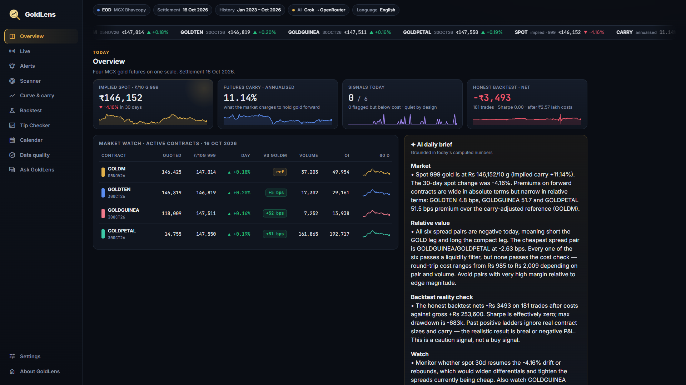
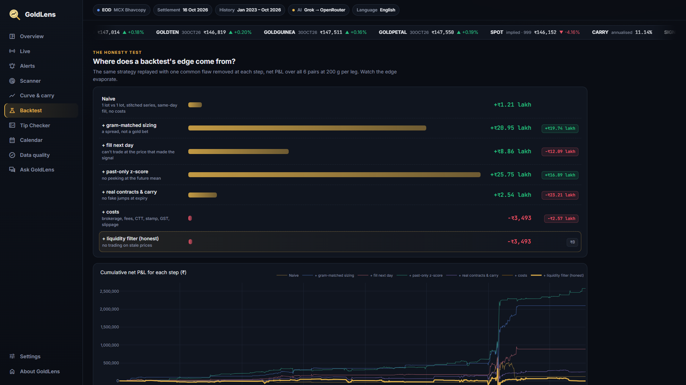
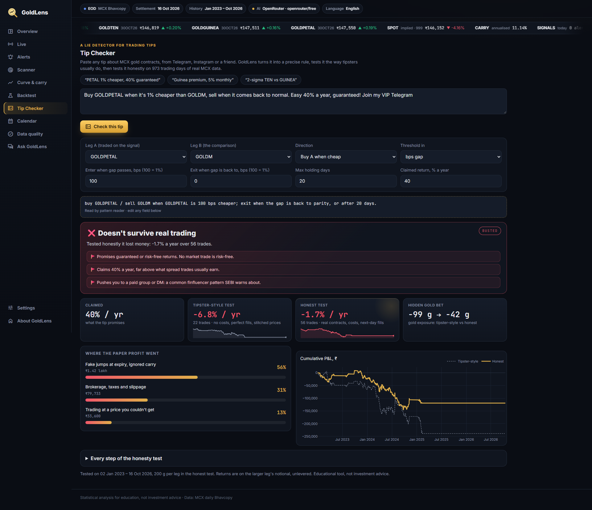
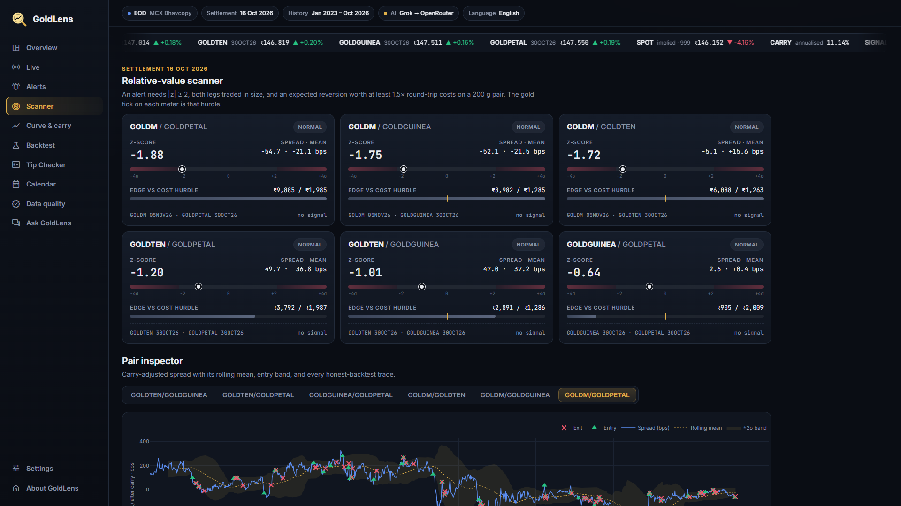
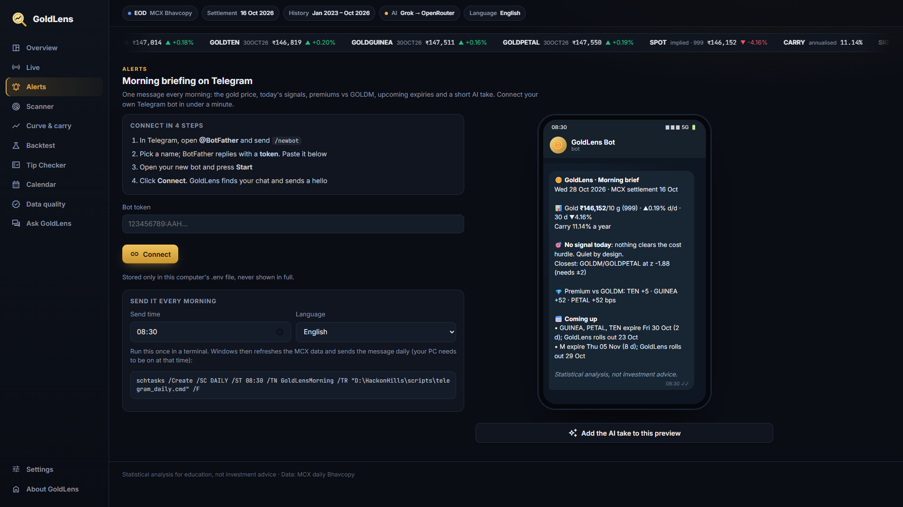

# GoldLens

**AI-powered relative-value intelligence for MCX gold futures.** Rigorous, cost-aware, and honest about when there is no edge.

Hack in Hills '26 · PS 03 Commodity Derivatives Intelligence · Team TechFast (Revant Raj, Md. Aftab)

MCX lists four gold futures on the same metal: GOLDM, GOLDTEN, GOLDGUINEA and GOLDPETAL. Lot sizes, quote bases, purity and expiry dates all differ, so their prices can't be compared at a glance. GoldLens puts all four on one scale (₹ per 10 g of 999 gold), finds the gaps that are actually unusual, tests them walk-forward after real costs, checks trading tips against the same honest test, and has an AI analyst explain the result in plain English or Hindi, on the dashboard or on Telegram.



## Results at a glance

All numbers come from 973 trading days of real MCX settlement data (Jan 2023 to Oct 2026), 6 contract pairs, 200 g per leg.

| | |
|---|---|
| Typical backtest (stitched prices, look-ahead, no costs) | **+₹25.75 lakh** |
| Same idea, marked on the real contracts with rolls and carry | +₹2.54 lakh |
| After brokerage, exchange fees, CTT, stamp duty, GST and slippage | **−₹3,493** over 181 trades |
| Hidden gold exposure, naive vs honest | 186 g vs 13 g |
| A "40% a year, guaranteed" tip, tested honestly | **−1.7% a year** |

GoldLens shows each of these steps on screen, so a fake edge can't hide.

| Honesty test | Tip Checker |
|---|---|
|  |  |
| **Scanner** | **Telegram morning brief** |
|  |  |

The pitch deck is in [`deck/GoldLens-Pitch.pptx`](deck/GoldLens-Pitch.pptx), with a spoken script in each slide's notes.

## Quick start

```bash
pip install -r requirements.txt
python -m goldlens.ingest --start 2023-01-01   # download + validate MCX Bhavcopy (resumable, cached in data/raw)
python -m goldlens.web                          # the whole website: http://127.0.0.1:8000
```

One server runs everything: the animated landing page at `/` and the full dashboard at `/app` (Overview, Live, Alerts, Scanner, Curve & carry, Backtest, Tip Checker, Calendar, Data quality, Ask GoldLens). The older Streamlit version of the dashboard still works as a backup: `streamlit run app.py`.

Optional keys go in `.env` (copy `.env.example`):

| Variable | Turns on | Where to get it |
|---|---|---|
| `ANTHROPIC_API_KEY` | AI analyst via Claude: brief, alert explanations, Q&A (used first if set) | console.anthropic.com |
| `XAI_API_KEY` | AI analyst via xAI Grok (`XAI_MODEL` optional, default `grok-4.7`) | console.x.ai (the account needs credits) |
| `OPENROUTER_API_KEY` | AI analyst via OpenRouter **free models** (`google/gemma-4-31b-it:free`, then `openrouter/free`); 50 free requests a day | openrouter.ai/keys |
| `TELEGRAM_BOT_TOKEN`, `TELEGRAM_CHAT_ID` | Morning briefing on your phone (`TELEGRAM_LANGUAGE`, default English) | Set from the dashboard's **Alerts** tab |
| `UPSTOX_ANALYTICS_TOKEN` | **Live** tab: real-time MCX quotes every 10 s | Free Upstox account → Developer Apps → **Analytics** tab → Generate Token (read-only, valid 1 year) |
| `UPSTOX_REFRESH_SECONDS` | Live refresh interval (default 10, min 5) | — |

The AI keys are tried in order (Claude → Grok → OpenRouter). A provider that fails for a lasting reason, such as a rejected key or no credits, is skipped for the rest of the session. Answers are cached, so a repeated brief costs no extra requests.

Without any keys the app still works: the brief falls back to a template and the Live tab shows the daily scanner.

## Morning briefing on Telegram

Every morning GoldLens can send **one** Telegram message: the gold price (day and 30-day change), carry, today's signals (or the pair closest to one), each contract's premium vs GOLDM, upcoming expiries with the day GoldLens rolls out, and a short AI take.

Connect from the dashboard's **Alerts** tab: create a bot with **@BotFather** (`/newbot`), paste the token, press **Start** in your bot, and click **Connect**. GoldLens checks the token, finds your chat, saves both to `.env` (only on the machine running the app) and sends a hello. The tab also shows a phone preview of the exact message and the command to schedule it:

```bash
schtasks /Create /SC DAILY /ST 08:30 /TN GoldLensMorning /TR "D:\HackonHills\scripts\telegram_daily.cmd" /F
```

The scheduled job runs `python -m goldlens.notify`, which refreshes the MCX data and sends the morning message once per settlement date. `python -m goldlens.notify --alerts-only` sends any new alert on its own, for runs during the day.

## Tip Checker

Paste a trading tip ("Buy GOLDPETAL when it's 1% cheaper than GOLDM, 40% a year guaranteed!"). GoldLens turns it into a precise rule: an instant pattern reader handles clear wording, including common Hinglish, and the AI handles messy wording. Every field of the rule stays editable. The rule is replayed through the same honesty ladder as the main backtest, and the verdict shows the claimed return next to a tipster-style test and an honest one, which flaw created how much of the paper profit, the hidden gold exposure, and red flags such as guaranteed returns or paid-group pitches. It only checks rules about the gap between MCX gold contracts; anything else is reported as out of scope.

`data/` ships with the cached history, so the dashboard runs offline. Re-run the ingest command any day to append new sessions.

## Website architecture

| Part | What it is |
|---|---|
| `goldlens/` | The backend: data, analytics, backtests, Tip Checker, AI, Telegram |
| `goldlens/web/server.py` | FastAPI server: `/` landing page, `/app/*` dashboard pages, `/api/*` actions, `/data.js` live numbers for the landing page |
| `goldlens/web/pages.py` | Every dashboard page as server-rendered HTML; interactions swap fragments with htmx |
| `goldlens/charts.py` | Plotly figures; the server bundles plotly.js, so charts need no CDN |
| `site/` | The landing page (GSAP + ScrollTrigger). Also works as static files: `python scripts/export_site_data.py` writes `site/data.js` for GitHub Pages |

Settings (strategy and costs) are stored per visitor in a cookie. Anything that writes to `.env` (Telegram connect, language) only works from the machine running the server.

## What's inside

| Module | Does |
|---|---|
| `goldlens/ingest.py` | Pulls MCX's public date-wise Bhavcopy, rejects files whose dates don't match the request, flags holidays, parses `04SEP2026` expiries, trims padded symbols, caches every day as JSON and builds a tidy parquet panel |
| `goldlens/normalise.py` | `px10 = price × (10 / quoted grams) × (999 / purity)`; days and business days to expiry; active contract (rolled N business days before expiry) vs stitched front month; contract calendar |
| `goldlens/analytics.py` | A daily weighted regression `ln px10 = ln spot + carry × τ + premium[contract type]`, giving implied carry and each contract's carry-adjusted premium; pair spreads; past-only z-scores; roll-down decomposition |
| `goldlens/backtest.py` | Day-by-day walk-forward pair backtester: gram-matched legs, T+1 fills, real contract P&L with rolls, full Indian cost stack, liquidity filter. Each honesty fix can be switched on or off, and the "edge ladder" shows what each one removes. Also attributes P&L against gold's own move |
| `goldlens/signals.py` | Today's scanner. An alert needs a statistically unusual gap, liquid legs, and an expected reversion worth at least 1.5× round-trip costs. Builds the JSON fact sheet |
| `goldlens/live.py` | Live quotes from the Upstox API (Analytics Token, full market quote with bid/ask). Live spreads are scored against the same past-only statistics as the daily scanner, and the cost check uses the real bid-ask spread. It falls back to daily data on a missing token, auth or network errors, or a failed unit check, and marks quotes stale when the market is closed |
| `goldlens/ai.py` | The AI analyst: Claude (`claude-opus-5-5`), xAI Grok (`grok-4.7`) or OpenRouter free models, tried in order: daily brief, per-alert explanation and Q&A, grounded only in the fact sheet. Server-side refusal fallback, disk cache, template fallback |
| `goldlens/tipcheck.py` | Tip Checker: tip text to rule (pattern reader, AI fallback), the honesty ladder for that rule, profit breakdown, gold exposure and verdict |
| `goldlens/telegram.py`, `goldlens/notify.py` | Telegram Bot API client, message formatting, and the daily brief/alert job with once-only delivery |
| `goldlens/ui.py` | Design system: theme, chart template and HTML components |
| `app.py` | Backup Streamlit dashboard: Overview · Live · Scanner · Curve & carry · Backtest · Tip Checker · Calendar · Data quality · Ask GoldLens |

## Rigor checklist

- **No look-ahead**: z-scores use only past data and trades fill at the next day's settlement. `tests/test_goldlens.py::test_backtest_has_no_lookahead` checks that cutting off future data never changes past P&L.
- **Real contracts**: P&L is marked on the exact contracts held and rolled before the tender period, never on a stitched series.
- **Real costs**: brokerage, MCX transaction charges, SEBI fee, CTT (sell side), stamp duty (buy side), 18% GST and tick slippage on every fill, rolls included. All of these are editable in the sidebar.
- **Liquidity aware**: zero-volume rows repeat the previous close, so they never generate a signal; thin days are skipped.
- **Attribution**: daily P&L is regressed on gold's rupee move, so a hidden gold bet can't pass as edge.
- **Honest outcome**: if no edge survives costs, the dashboard says so.

## Cost assumptions (defaults)

| Item | Default |
|---|---|
| Brokerage | ₹20 per order per leg |
| MCX transaction charge | 0.0021% of turnover |
| SEBI fee | ₹10 per crore |
| CTT | 0.01%, sell side |
| Stamp duty | 0.002%, buy side |
| GST | 18% on brokerage + exchange + SEBI fees |
| Slippage | 2 ticks per lot per fill vs settlement |

These are approximate retail rates. Check them against your broker's contract note.

## Tests

```bash
python -m pytest -q
```
